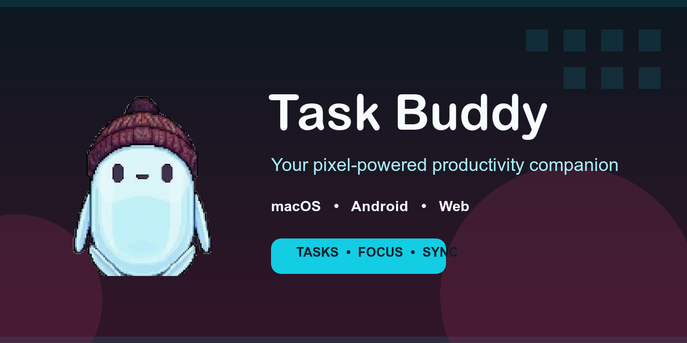
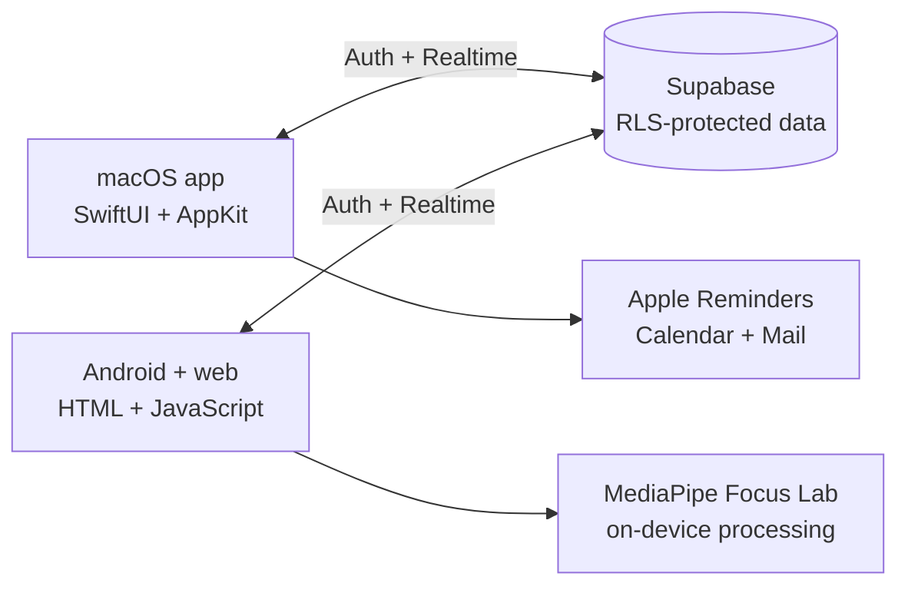

<p align="center">
  A pixel-art productivity companion for macOS, Android, and the web.<br>
  Keep tasks, reminders, mail, calendar events, and focus sessions close without opening another dashboard.
</p>

<p align="center">
  <strong>Currently in beta</strong> · Built with Swift, Supabase Realtime, and MediaPipe
</p>

<p align="center">
  
  
  
  
  
  <a href="https://github.com/walruto/task-buddy/pulls"></a>
</p>

<p align="center">
  <a href="#overview">Overview</a> ·
  <a href="#features">Features</a> ·
  <a href="#getting-started">Getting started</a> ·
  <a href="#architecture">Architecture</a> ·
  <a href="#privacy-model">Privacy</a> ·
  <a href="#contributing">Contributing</a>
</p>

| Always nearby | Synced everywhere | Built for focus |
| --- | --- | --- |
| A floating Buddy that stays above desktop and fullscreen apps. | Tasks update across Mac, Android, and web through Supabase Realtime. | On-device camera cues help you stay present without uploading frames. |

## Overview

Task Buddy turns everyday productivity tools into one small companion. On macOS, Buddy floats above your workspace and brings tasks, reminders, calendar events, and recent mail into a lightweight Control Center. On Android and the web, the same tasks stay synchronized and can launch an on-device Focus Lab.

The project is intentionally personal and direct: no giant dashboard, no analytics layer, and no camera uploads. Buddy stays visible when useful and gets out of the way when it is not.

**What makes Task Buddy different:**

- **A companion, not another dashboard.** Add or complete a task from Buddy's speech bubble, then return to what you were doing.
- **Native where it matters.** The Mac app works with Apple Reminders, Calendar, Mail, local notifications, global shortcuts, and launch at login.
- **Private by design.** Focus frames stay on the device, mail bodies are not read, and Supabase data is protected per user with Row Level Security.
- **Useful without cloud sync.** When Supabase is not connected, Buddy Tasks fall back to Apple Reminders on the Mac.
- **One character across every surface.** The supplied Buddy artwork and animation language carry from desktop to phone.

## Features

### macOS companion

- Keeps a draggable, resizable Buddy above normal and fullscreen windows on every desktop.
- Adds and completes Buddy Tasks from a pixel speech bubble or the separate Control Center.
- Syncs tasks with the phone through Supabase, with Apple Reminders as the local fallback.
- Shows Apple Calendar events and recent Apple Mail inbox messages without reading message bodies.
- Opens the matching Gmail webpage for supported messages.
- Schedules quiet local reminders and stays available from the menu bar.
- Includes quick launchers for internet search (`Option + Shift + Return`) and apps or websites (`Option + Shift + Space`).

Closing the Control Center does not quit Buddy. Use its menu-bar icon or right-click menu to reopen the window, sync, or quit.

### Android and web companion

- Adds, categorizes, schedules, completes, and synchronizes tasks in real time.
- Schedules native Android notifications at task deadlines.
- Provides a camera-based Focus Lab with 25, 45, and 60-minute sessions.
- Supports Screen Work and Paper Homework modes, calibration, sensitivity controls, and distraction alerts.
- Stores aggregate focus statistics while keeping camera frames on the device.

## Architecture



The native Mac target owns the floating window, Control Center, Apple integrations, shortcuts, reminders, and menu-bar behavior. The dependency-free mobile interface is shared with the Android WebView wrapper. Supabase provides authentication and synchronized task and focus records; device-specific features remain on the device.

## Privacy model

- Camera frames, face landmarks, calibration samples, and live focus timelines are processed locally and are never uploaded or saved.
- Apple Mail message bodies are not read, and Task Buddy never stores a mail password.
- Only the Supabase publishable key is bundled. Secret and service-role keys must never be added to a client.
- Supabase Row Level Security limits tasks and focus sessions to their owner.
- The Mac stores only a restricted Supabase session token in `~/Library/Application Support/TaskBuddy/supabase-session.json`.
- There is no analytics SDK, Google OAuth client, or Google Cloud project.

Focus detection is a heuristic based on face presence, head direction, coarse gaze, eye openness, and tab visibility. It does not identify people, infer emotions, or provide a medical or accessibility diagnosis.

## Project layout

| Path | Purpose |
| --- | --- |
| `Sources/TaskBuddyApp/` | Native macOS application, windows, menus, permissions, and integrations |
| `Sources/TaskBuddyCore/` | Shared task, session, and Supabase logic |
| `mobile/` | Dependency-free phone and web interface |
| `android/` | Android WebView wrapper and notification scheduling |
| `supabase/` | Database migrations and Row Level Security policies |
| `Tests/` | Swift tests for core behavior and authentication flows |
| `scripts/` | Packaging, asset preparation, and mobile test scripts |

## Principles

- **Stay present, not noisy.** Buddy should be one glance or one shortcut away without demanding a full-screen workflow.
- **Keep sensitive work local.** Camera processing and Apple-service access belong on the device.
- **Degrade gracefully.** Core Mac task behavior still works when phone sync is unavailable.
- **Share behavior, not platform compromises.** Mac and Android use their native capabilities while presenting the same tasks and Buddy personality.
- **Be explicit about limitations.** Focus signals are estimates, sideloaded builds are labeled, and unsupported integrations are documented.

## Getting started

### Requirements

#### macOS development

- macOS 14 or newer
- Xcode 15.3 or newer
- Swift 5.10 toolchain
- ImageMagick only when regenerating sprites or the app icon: `brew install imagemagick`

#### Android development

- JDK 17
- Android SDK with API 35 build tools
- Android 8.0 (API 26) or newer on the device

### Run the Mac app

For development:

```sh
swift run TaskBuddy
```

For the complete app behavior, including launch at login, package and install the app bundle:

```sh
./scripts/package-app.sh
ditto "dist/Task Buddy.app" "/Applications/Task Buddy.app"
open "/Applications/Task Buddy.app"
```

The packaging script creates an ad-hoc signed personal build. Public distribution requires a Developer ID signature and notarization.

On first launch, grant Reminders and Calendar access as needed. To show mail, add an account to Apple Mail, choose **Connect Apple Mail** in Task Buddy, and allow the macOS Automation permission.

### Configure Supabase sync

1. Create a Supabase project and apply the migrations in `supabase/migrations/`.
2. Copy `Sources/TaskBuddyApp/Resources/SupabaseConfig.example.json` to `SupabaseConfig.json`.
3. Copy `mobile/config.example.js` to `mobile/config.js`.
4. Put the same project URL and public publishable key in both files.
5. In **Authentication → URL Configuration → Redirect URLs**, allow `taskbuddy://reset-password`.
6. Create an account in either app, confirm the email if required, and sign into the other app with the same account.

The real configuration files are intentionally ignored by Git. Do not commit passwords, session tokens, private keys, or Supabase secret/service-role keys.

### Build the Android app

```sh
./scripts/package-android.sh
```

The generated APK is written to `dist/TaskBuddy-Android.apk`. It uses Android's debug signature and is intended for personal sideloading, so Android may ask you to approve installation from the browser or file manager that opens it.

## Run the checks

```sh
env CLANG_MODULE_CACHE_PATH=/tmp/taskbuddy-clang-cache \
SWIFTPM_MODULECACHE_OVERRIDE=/tmp/taskbuddy-swiftpm-cache \
swift test

./scripts/test-mobile.sh
./scripts/test-android-notifications.sh
```

## Contributing

Issues and pull requests are welcome. Keep changes focused, preserve the local-first privacy model, and run the relevant Swift or mobile checks before opening a pull request.

- Report a bug or suggest a feature in [GitHub Issues](https://github.com/walruto/task-buddy/issues).
- Explain user-facing behavior changes in the pull request.
- Never commit real Supabase configuration, credentials, session files, APKs, or signing material.

## Character assets

Runtime animation frames live in `Sources/TaskBuddyApp/Resources/Character/`. They are transparent 256×256 PNGs with a common baseline and include idle, wave, happy, thinking, alert, confused, angry, looking-around, and dance animations.

The project uses the supplied Buddy artwork. To rebuild the fallback frame set, run:

```sh
./scripts/prepare-character-assets.sh
```

## Current limitations

- Google Tasks is intentionally not integrated because real access requires Google authentication or a Google-hosted bridge.
- The first Focus Lab session needs internet access to download the pinned MediaPipe runtime and model.
- The Android APK is not a Play Store release.
- Public macOS distribution still requires signing and notarization.
